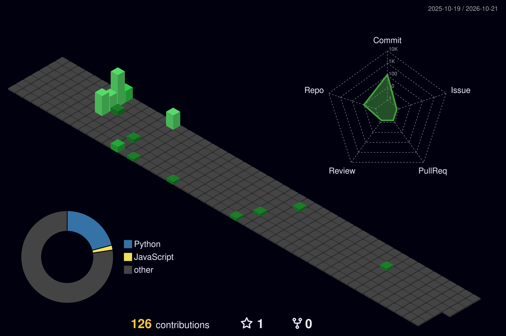

  

<h1 align="center">Hi, I'm Dhava 👋</h1>

  

  
  
  

  

---

## 🚀 About Me

I'm a **fresh graduate in Telecommunication Engineering** with a deep passion for **Software Development & Digital Intelligence**. I design the interface, then build it.

- 🧱 Building systems **from zero**
- 🔍 **Reverse-engineering** tech to understand *why it works*
- 📦 Shipping **real, usable products**, not just demos
- 🎨 Designing in **Figma / Photoshop**, building with **React & Expo**

I'm also the founder of **Spectrum.Byte**, a tech initiative focused on
**device repair, system optimization, data recovery, and software-based solutions**,
_built with a structured_ & _professional mindset_.

---

## 🎮 Let's Play With Me

<picture>
  <source media="(prefers-color-scheme: dark)" srcset="https://raw.githubusercontent.com/dhava-wirayuda/dhava-wirayuda/output/pacman-contribution-graph-dark.svg">
  <source media="(prefers-color-scheme: light)" srcset="https://raw.githubusercontent.com/dhava-wirayuda/dhava-wirayuda/output/pacman-contribution-graph.svg">
  
</picture>

---

## 🗒️ My Analytics

  

  

  

---

## 🧠 Tech Interests & Focus

  
  
  
  

---

## 🛠 Tech Stack

### 💻 Software & Cloud

  

### 🎨 Design

  

### 🔧 Hardware & Networking
- ESP32, LoRa, P2P Communication Infrastructures
- Moderate Networking & Telecommunication Systems
- System Troubleshooting & Optimization

---

## 📌 Featured Projects

<table>
  <tr>
    <td width="50%" valign="top">
      <h3>📱 Veston: Fashion E-Commerce App</h3>
      
Designed in Figma and built as a working mobile app, tested live on a real device.

      <ul>
        <li>React Native + Expo</li>
        <li>Figma UI/UX</li>
        <li>Monochrome streetwear identity</li>
      </ul>
    </td>
    <td width="50%" valign="top">
      <h3>🖥️ Hyperrealist: Creative Agency Website</h3>
      
Bold dark landing page, designed and developed end-to-end.

      <ul>
        <li>Figma → live website</li>
        <li>High-contrast typography</li>
        <li>Responsive layout</li>
      </ul>
    </td>
  </tr>
  <tr>
    <td width="50%" valign="top">
      <h3>🤖 Chatbot NLP Base</h3>
      
Word tokenizer with transformer and Wikipedia dataset.

      <ul>
        <li>Transformer</li>
        <li>Wikipedia Engine</li>
        <li>Python</li>
      </ul>
    </td>
    <td width="50%" valign="top">
      <h3>🌐 Wireless Sensor Network</h3>
      
Transmitting sensor data via LoRa and sending it to a server with ESP32.

      <ul>
        <li>LoRa Ebyte E220</li>
        <li>Data parsing</li>
        <li>Web server</li>
      </ul>
    </td>
  </tr>
</table>

---

## 📫 Let's Connect

  
  
  

  <i>Open for collaboration, product discussions, and early-stage tech opportunities.</i>

  

